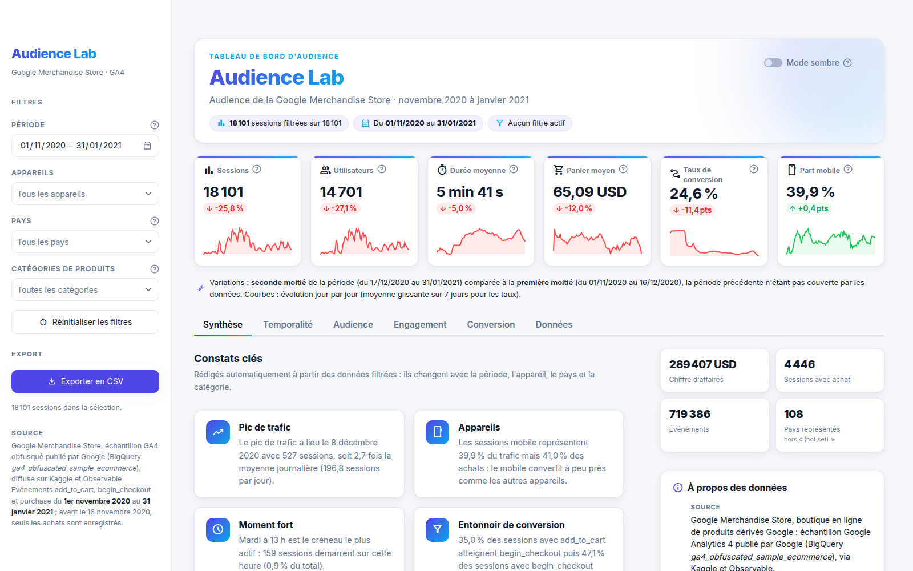
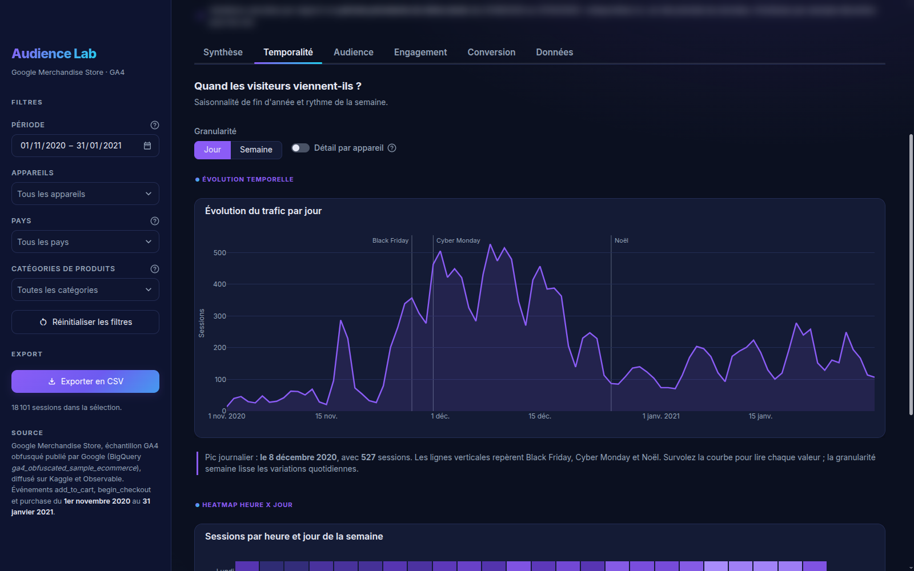
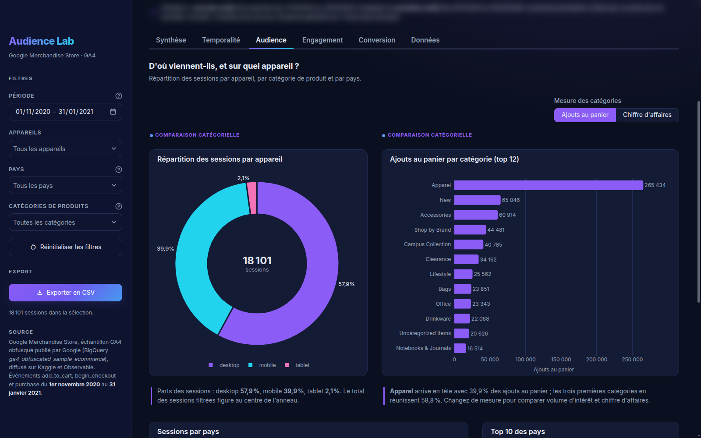
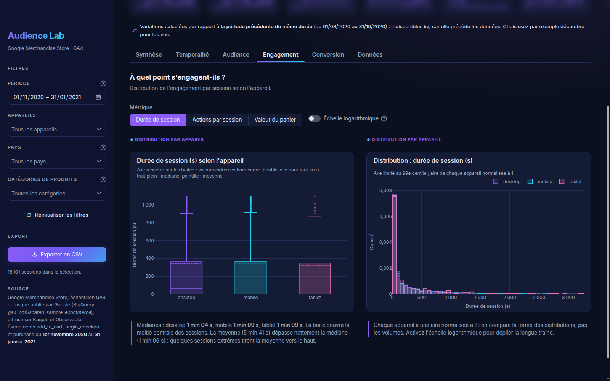
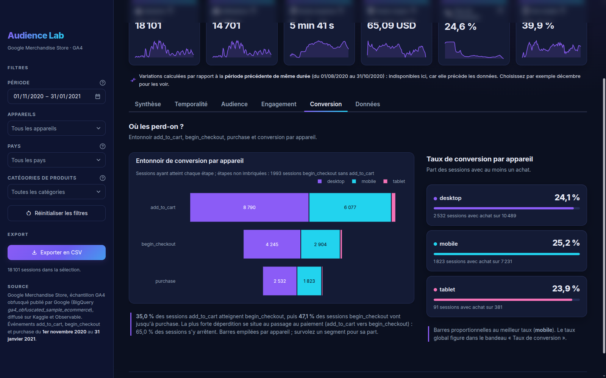
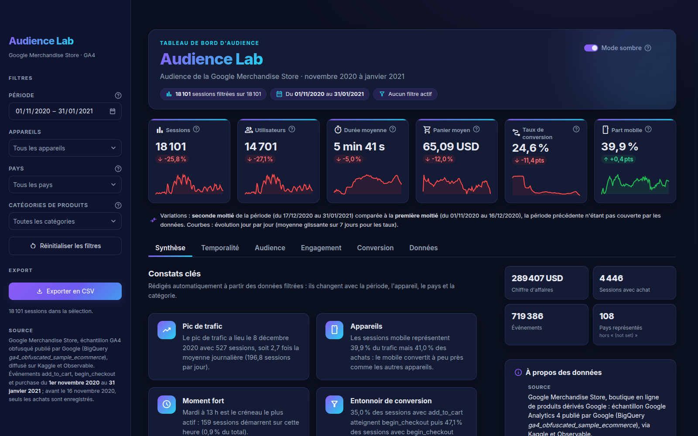
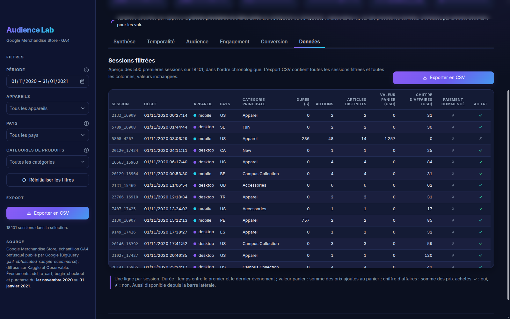

<div align="center">

# Audience Lab

**Tableau de bord d'audience de la Google Merchandise Store (Google Analytics 4, novembre 2020 à janvier 2021)**

[](https://audience-lab.streamlit.app)


### [Ouvrir l'application en ligne : audience-lab.streamlit.app](https://audience-lab.streamlit.app)

[Rapport d'analyse (PDF)](rapport/rapport_analyse.pdf) · [Support de soutenance (PDF)](soutenance/presentation.pdf) · [Déroulé de la démonstration](soutenance/deroule_demo.md) · [Notebook de préparation](notebooks/01_preparation_donnees.ipynb)

</div>



<sub>Thème clair par défaut, thème sombre via la bascule de thème de l'en-tête (aperçu plus bas).</sub>

> Qui visite la boutique en ligne de Google, quand, sur quel appareil, et où la boutique perd-elle ses acheteurs ? Audience Lab traite le trafic d'une vraie boutique en ligne comme l'audience d'un média : 758 884 événements bruts nettoyés, reconstitués en 18 101 sessions, explorables par période, appareil, pays et catégorie de produit.

## Sommaire

1. [Contexte du projet](#contexte-du-projet)
2. [Les chiffres clés](#les-chiffres-clés)
3. [Données](#données)
4. [Fonctionnalités de l'application](#fonctionnalités-de-lapplication)
5. [Correspondance avec le cahier des charges](#correspondance-avec-le-cahier-des-charges)
6. [Arborescence du dépôt](#arborescence-du-dépôt)
7. [Exécution locale](#exécution-locale)
8. [Livrables](#livrables)
9. [Source, licence et crédits](#source-licence-et-crédits)

## Contexte du projet

| | |
|---|---|
| **Projet** | Projet pratique : Plateforme d'Analyse et de Visualisation d'Audience Média |
| **Module** | Visualisation de Données avec Python |
| **Enseignant** | Dr. Zakaria Sawadogo |
| **Établissement** | Université Aube-Nouvelle, Master 1 Intelligence Artificielle |
| **Auteur** | Abdoul-Aziz ZOROM |
| **Date** | 19 octobre 2026 |

Le sujet demande toute la chaîne de traitement : nettoyage avec pandas, indicateurs clés, visualisations Seaborn et Plotly Express, puis un tableau de bord Streamlit déployé. L'analyse suit quatre questions directrices, une par onglet de l'application :

| Question | Ce que l'on mesure | Onglet |
|---|---|---|
| Quand les visiteurs viennent-ils ? | saisonnalité, jours et heures de pointe | Temporalité |
| D'où et sur quel appareil ? | parts par appareil, pays et catégorie de produit | Audience |
| À quel point s'engagent-ils ? | durée de session, actions, valeur ajoutée au panier | Engagement |
| Où les perd-on ? | entonnoir add_to_cart, begin_checkout, purchase | Conversion |

## Les chiffres clés

Sur la période complète, sans filtre (mêmes valeurs dans le notebook, l'application et le rapport) :

| Sessions | Utilisateurs | Durée moyenne | Panier moyen | Taux de conversion | Part mobile |
|:---:|:---:|:---:|:---:|:---:|:---:|
| **18 101** | **14 701** | **5 min 41 s** | **65,09 USD** | **24,6 %** | **39,9 %** |

Quatre constats ressortent de l'analyse (détail dans le [rapport](rapport/rapport_analyse.pdf)) :

- **Une audience très saisonnière.** Record de trafic le 8 décembre 2020 avec 527 sessions, soit 2,7 fois la moyenne journalière ; la fenêtre du 23 novembre au 18 décembre concentre 53,8 % des sessions.
- **Un trafic de semaine.** Le mardi attire 1,9 fois plus de sessions que le dimanche ; le créneau le plus actif est le mardi à 13 h (159 sessions).
- **L'appareil ne fait pas la différence.** Le mobile pèse 39,9 % du trafic et 41,0 % des achats ; la conversion est presque identique sur desktop, mobile et tablet.
- **Les acheteurs se perdent au panier.** Seules 35,0 % des sessions avec add_to_cart atteignent begin_checkout, puis 47,1 % des sessions avec begin_checkout vont jusqu'à purchase.

Chiffre d'affaires de la période : 289 407 USD.

## Données

| | |
|---|---|
| **Source** | Google Merchandise Store, sous-ensemble du jeu public BigQuery `ga4_obfuscated_sample_ecommerce` publié par Google ; diffusion Observable [`@observablehq/google-merchandise-sales-data`](https://observablehq.com/@observablehq/google-merchandise-sales-data), reprise sur Kaggle [`mexwell/google-merchandise-sales-data`](https://www.kaggle.com/datasets/mexwell/google-merchandise-sales-data) |
| **Licence** | Kaggle indique une licence « Other » renvoyant à la source Observable ; jeu de démonstration diffusé publiquement par Google, utilisé ici à des fins pédagogiques non commerciales, source citée. Identifiants obfusqués par Google : aucune donnée personnelle. |
| **Période** | du 1er novembre 2020 au 31 janvier 2021 (92 jours) |
| **Fichiers bruts** (`data/raw/`) | `events.csv` (758 884 lignes, 7 colonnes), `items.csv` (1 381 articles), `users.csv` (270 154 utilisateurs) |
| **Fichiers traités** (`data/processed/`) | `events_clean.parquet` (719 386 événements) et `sessions.parquet` (18 101 sessions), 4,8 Mo au total |

Le jeu respecte les critères du sujet : une variable temporelle (horodatage à la seconde), des variables numériques (prix, durée de session, nombre d'événements, valeur du panier, chiffre d'affaires) et des variables catégorielles (appareil, type d'événement, pays, catégorie et marque de l'article). Les valeurs des données restent en anglais (`desktop`, `mobile`, `tablet`, `add_to_cart`, `Apparel`...) ; tout le reste est en français.

**Préparation, en chiffres** (notebook [`01_preparation_donnees.ipynb`](notebooks/01_preparation_donnees.ipynb)) :

- 39 498 doublons exacts supprimés (758 884 puis 719 386 événements), surtout des begin_checkout envoyés plusieurs fois ;
- 4 555 pays manquants conservés sous la modalité `(not set)`, convention de Google Analytics, plutôt que supprimés ou inventés ;
- dates converties en `datetime`, indexation temporelle (`set_index`, `resample`), variables dérivées (jour, heure, jour de la semaine, mois) ;
- agrégation en 18 101 sessions (clé `user_id` + `ga_session_id`), 14 701 utilisateurs, 108 pays plus `(not set)` ;
- valeurs aberrantes repérées par la règle IQR, **signalées et conservées** (elles portent 42,4 % du chiffre d'affaires).

**Limite de collecte à connaître :** avant le 16 novembre 2020, seuls les achats sont enregistrés ; begin_checkout n'apparaît que le 23 novembre. Le rapport (section 8) montre que les taux conditionnels de l'entonnoir restent stables si l'on part du 23 novembre.

## Fonctionnalités de l'application

- **Barre latérale de filtres** (`st.sidebar`) : période, appareils, pays (classés par fréquence), catégories de produits, bouton de réinitialisation, export CSV.
- **Bandeau de six indicateurs** (`st.metric`) toujours visible : sessions, utilisateurs, durée moyenne, panier moyen, taux de conversion, part mobile, chacun avec sa variation et sa petite courbe quotidienne. La variation compare la sélection à la période précédente de même durée ; si celle-ci sort des données, l'application compare la seconde moitié de la période à la première et l'annonce en clair.
- **Six onglets** : Synthèse (constats rédigés automatiquement selon les filtres), Temporalité, Audience, Engagement, Conversion, Données.
- **Graphiques Plotly Express** (`st.plotly_chart`) : `px.line`, `px.imshow`, `px.pie`, `px.bar`, `px.choropleth`, `px.box`, `px.histogram`, `px.funnel`, avec survol en valeurs réelles.
- **Export CSV** (`st.download_button`) des sessions filtrées, en UTF-8 lisible par Excel, depuis la barre latérale et l'onglet Données.
- **Deux thèmes** : thème clair par défaut, thème sombre (« Nuit analytique », pensé pour la projection) via la bascule de thème de l'en-tête ; le CSS et chaque figure suivent le thème.
- **Robustesse** : message « Aucune donnée pour ces filtres » au lieu d'une erreur, données en Parquet et mises en cache (`st.cache_data`), 95 tests automatisés.

<sub>Captures des onglets en thème sombre.</sub>

<table>
  <tr>
    <td width="50%"><br><sub><b>Temporalité</b> : <code>px.line</code> par jour ou par semaine, puis heatmap heure x jour (<code>px.imshow</code>)</sub></td>
    <td width="50%"><br><sub><b>Audience</b> : anneau des appareils (<code>px.pie</code>), catégories (<code>px.bar</code>), carte des pays (<code>px.choropleth</code>)</sub></td>
  </tr>
  <tr>
    <td width="50%"><br><sub><b>Engagement</b> : boîtes (<code>px.box</code>) et distributions (<code>px.histogram</code>) par appareil</sub></td>
    <td width="50%"><br><sub><b>Conversion</b> : entonnoir par appareil (<code>px.funnel</code>) et taux par appareil</sub></td>
  </tr>
</table>

<details>
<summary><b>Thème sombre et onglet Données</b> (cliquer pour afficher)</summary>





</details>

## Correspondance avec le cahier des charges

Chaque exigence du sujet (`projet.pdf`) et l'endroit précis où la vérifier.

| Exigence du sujet | Où la trouver |
|---|---|
| **1.1** Données : au moins 1 variable temporelle, 2 numériques, 2 catégorielles | Notebook, sections 1 (inspection) et 6 (variables dérivées) ; rapport, section 2.3 ; [Données](#données) ci-dessus |
| **2.1.1** Inspection de la structure, valeurs manquantes et aberrantes | Notebook, sections 1 (`info()`, `describe()`, cardinalités), 2 (valeurs manquantes), 3 (doublons) et 8 (IQR, `sns.boxplot`) ; rapport, section 3 |
| **2.1.2** Conversion des dates en `datetime`, indexation temporelle | Notebook, section 4 (`pd.to_datetime`, `set_index`, `resample`) ; rapport, section 3.2 |
| **2.1.3** Variables agrégées (heure, jour de la semaine, mois) | Notebook, section 6 (variables au niveau événement) et section 7 (table des sessions) |
| **2.2** Volume total de visites, sessions ou transactions | Cartes `st.metric` « Sessions » et « Utilisateurs » (`app.py`, section 5, `bandeau_kpis`) ; notebook, section 9 ; rapport, section 4 |
| **2.2** Durée moyenne ou valeur moyenne par session | Cartes « Durée moyenne » et « Panier moyen » du bandeau ; notebook, section 9 ; rapport, section 4 |
| **2.2** Répartition de l'audience par appareil ou catégorie | Carte « Part mobile » ; onglet **Audience** (anneau des appareils, barres des catégories) ; notebook, section 9 ; rapport, section 4 |
| **2.3** Visualisations Seaborn et Plotly Express | Seaborn : notebook, section 10 ; Plotly Express : `audience/graphiques.py`, affiché dans `app.py` |
| **2.3.1** Évolution temporelle du trafic avec filtres interactifs | Onglet **Temporalité**, `px.line` (`fig_evolution`), granularité jour ou semaine, détail par appareil, filtres de la barre latérale ; notebook, section 10.1 ; rapport, section 5.1 |
| **2.3.2** Comparaison catégorielle (barres ou camembert) | Onglet **Audience** : `px.pie` (`fig_parts_appareils`), `px.bar` (`fig_categories`, `fig_top_pays`), `px.choropleth` ; notebook, section 10.2 (`sns.barplot`) ; rapport, section 5.2 |
| **2.3.3** Distribution de l'engagement selon l'appareil (boxplot ou densité) | Onglet **Engagement** : `px.box` (`fig_engagement_boite`) et `px.histogram` (`fig_engagement_densite`) ; notebook, section 10.3 (`sns.boxplot`, `sns.histplot(kde=True)`) ; rapport, section 5.3 |
| **2.3.4** Heatmap heures de pointe x jours de la semaine | Onglet **Temporalité**, `px.imshow` (`fig_heatmap_heure_jour`) ; notebook, section 10.4 (`sns.heatmap(annot=True, cmap="Blues")`) ; rapport, section 5.4 |
| **2.4** Application Streamlit `app.py` intégrant les analyses | [`app.py`](app.py), en ligne sur [audience-lab.streamlit.app](https://audience-lab.streamlit.app) ; rapport, section 6 |
| **2.4** Panneau latéral `st.sidebar` (période, catégorie, appareil) | `app.py`, section 4 : période, appareils, pays, catégories de produits, réinitialisation |
| **2.4** Métriques clés `st.metric` | `app.py`, section 5 (`bandeau_kpis`) : six cartes avec variation et courbe |
| **2.4** Graphiques Plotly Express `st.plotly_chart` | `app.py`, fonction `graphique` (section « Éléments communs des onglets ») et section 6 (onglets) |
| **2.4** Export CSV des données filtrées `st.download_button` | `app.py`, section 4 (`bouton_export`) : barre latérale et onglet **Données** |
| **Livrable 1** Code source propre et commenté, notebook `.ipynb` | [`app.py`](app.py), package [`audience/`](audience/), [`notebooks/01_preparation_donnees.ipynb`](notebooks/01_preparation_donnees.ipynb) (exécuté, sorties conservées), [`tests/`](tests/) (95 tests) |
| **Livrable 2** Rapport d'analyse (données, nettoyage, interprétation, conclusions) | [`rapport/rapport_analyse.pdf`](rapport/rapport_analyse.pdf) (19 pages ; source HTML et CSS dans `rapport/`) |
| **Livrable 3** Démonstration orale du tableau de bord | [Application en ligne](https://audience-lab.streamlit.app), [`soutenance/presentation.pdf`](soutenance/presentation.pdf), [`soutenance/deroule_demo.md`](soutenance/deroule_demo.md) |

## Arborescence du dépôt

```
audience-lab/
├── app.py                         # point d'entrée Streamlit (filtres, KPI, onglets)
├── audience/                      # code de l'application
│   ├── donnees.py                 #   chargement, filtres, période de référence
│   ├── kpis.py                    #   indicateurs et mise en forme française
│   ├── constats.py                #   constats rédigés automatiquement
│   ├── graphiques.py              #   figures Plotly Express
│   └── theme.py                   #   thèmes sombre et clair
├── data/
│   ├── raw/                       # events.csv, items.csv, users.csv (source)
│   └── processed/                 # events_clean.parquet, sessions.parquet
├── notebooks/
│   └── 01_preparation_donnees.ipynb
├── rapport/                       # rapport_analyse.pdf, sa source HTML et CSS, figures/
├── soutenance/                    # presentation.html, presentation.pdf, deroule_demo.md
├── scripts/
│   ├── telecharger_donnees.py     # téléchargement contrôlé des données brutes
│   ├── generer_pdf.sh             # impression HTML vers PDF (Chromium sans interface)
│   └── numeroter_sommaire.py      # numéros de page du sommaire du rapport
├── tests/                         # 95 tests pytest
├── docs/
│   ├── captures/                  # captures d'écran de l'application
│   ├── specs/                     # document de conception
│   └── plans/                     # plan de réalisation
├── .streamlit/config.toml         # thème de base et options du serveur
├── requirements.txt               # dépendances de l'application, versions exactes
└── requirements-dev.txt           # + Jupyter, nbconvert, pytest
```

## Exécution locale

Prérequis : Python 3.12 et Git. Les données brutes et traitées sont versionnées : l'application démarre sans étape préalable.

```bash
# 1. Récupérer le projet et créer l'environnement virtuel
git clone https://github.com/Abdazz/audience-lab.git
cd audience-lab
python -m venv .venv
source .venv/bin/activate            # Windows : .venv\Scripts\activate
pip install -r requirements-dev.txt  # requirements.txt suffit pour l'application seule

# 2. Lancer le tableau de bord (http://localhost:8501)
streamlit run app.py

# 3. Lancer les tests
pytest
```

Pour tout régénérer depuis la source :

```bash
# Retélécharger les données brutes (contrôle de l'en-tête et du nombre de lignes)
python scripts/telecharger_donnees.py

# Réexécuter le notebook de bout en bout : il réécrit data/processed/ et rapport/figures/
jupyter nbconvert --to notebook --execute --inplace notebooks/01_preparation_donnees.ipynb

# Regénérer les PDF (Chromium et pdftotext requis)
scripts/generer_pdf.sh rapport/rapport_analyse.html rapport/rapport_analyse.pdf
scripts/generer_pdf.sh soutenance/presentation.html soutenance/presentation.pdf
```

## Livrables

| Livrable | Fichier |
|---|---|
| Application Streamlit | [`app.py`](app.py), en ligne : https://audience-lab.streamlit.app |
| Notebook de pré-traitement | [`notebooks/01_preparation_donnees.ipynb`](notebooks/01_preparation_donnees.ipynb) |
| Rapport d'analyse | [`rapport/rapport_analyse.pdf`](rapport/rapport_analyse.pdf) |
| Support de soutenance | [`soutenance/presentation.pdf`](soutenance/presentation.pdf) (source : [`presentation.html`](soutenance/presentation.html)) |
| Déroulé de la démonstration | [`soutenance/deroule_demo.md`](soutenance/deroule_demo.md) |

## Source, licence et crédits

- Données : Google, *Google Analytics 4 ecommerce sample dataset* (`bigquery-public-data.ga4_obfuscated_sample_ecommerce`) ; Observable, *Google Merchandise Sales Data* ; reprise Kaggle `mexwell/google-merchandise-sales-data`. Jeu de démonstration public, utilisé à des fins pédagogiques, source citée ; les droits sur les données restent ceux de leurs auteurs.
- Code, rapport et support : Abdoul-Aziz ZOROM, projet du module Visualisation de Données avec Python (Master 1 IA, Université Aube-Nouvelle), 2026.
